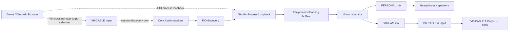

# AudioMixer Platform

Windows audio mixer with two independent mixes (PERSONAL and STREAM) and an Android remote-control app planned on top of one shared state model.

**Current milestone:** Stage 1 / Engine Probe. This repository now contains the first real Windows audio-engine prototype source. It is not a finished mixer, signed driver, APK, or installer.

## What exists in this revision

`src/AudioMixer.EngineProbe` is a Windows console probe that:

- enumerates audio sessions from a selected virtual render endpoint (Core Audio session manager);
- gets process IDs from those sessions;
- starts one NAudio 3 Process Loopback capture per PID;
- stores captured 48 kHz stereo float samples in bounded per-process ring buffers;
- feeds two independent bounded float output providers (implemented against NAudio 3's `IWaveProvider` span API);
- mixes every process independently into PERSONAL and STREAM using per-channel gains and mute states;
- outputs PERSONAL to a physical/default render endpoint and STREAM to a second render endpoint;
- persists route, gain, and mute settings in JSON;
- exposes commands for process routing and independent mix controls.

Source is written against the NAudio 3.3.0 public API. It has **not yet been compiled or run against a Windows audio device in this environment**. Treat this as an implementation candidate that needs the first Windows CI build and hardware test before it is called a working release.

## Architecture at this stage



The session endpoint is used to discover which PIDs the user routed into the ingress cable. Process Loopback itself captures the process tree and is not a replacement for session enumeration or Windows output routing.

## Test topology

Use official VB-Audio packages only; do not install unsigned/untrusted drivers.

| Purpose | Windows endpoint | How to use |
|---|---|---|
| App ingress/session discovery | `CABLE Input` (VB-CABLE playback/render endpoint) | Assign test applications to this endpoint in Windows Volume Mixer |
| Personal output | Headphones/speakers | Leave `PersonalOutputContains` empty to use Windows Multimedia default, or set a distinctive name substring |
| Stream output | `CABLE-A Input` (VB-CABLE A playback/render endpoint) | Engine sends STREAM here |
| OBS input | `CABLE-A Output` (VB-CABLE A recording/capture endpoint) | Add as an OBS Audio Input Capture source |

The base VB-CABLE provides one independent virtual cable. The A+B package adds two more independent cables (A and B) and is donationware. For Stage 1, the ingress cable and Stream cable are sufficient. A third cable is reserved for a future processed-microphone return path.

**Fail-safe:** for the first test, assign only one or two test apps to `CABLE Input` using Windows 11 → Settings → System → Sound → Volume mixer. Do not change the system-wide default output. If the engine is closed while an app is still routed to `CABLE Input`, that app may become inaudible until you switch it back to your headphones/speakers.

Official vendor page: https://vb-audio.com/Cable/VirtualCables.htm

## Build

Recommended runtime/developer baseline: Windows 11 (your reported build 26100 is above the conservative Process Loopback floor used here) and .NET 10 LTS SDK.

On Windows PowerShell, from the repository root:

```powershell
.\scripts\build.ps1
dotnet run --project .\src\AudioMixer.EngineProbe\AudioMixer.EngineProbe.csproj -c Release
# or create a publish folder:
.\scripts\publish.ps1
```

The included GitHub Actions workflow builds a Windows x64 framework-dependent publish artifact. It avoids the need to install Android Studio or the Android SDK for this milestone. The target machine must have the .NET 10 runtime installed. To build locally, only the .NET SDK and the NAudio NuGet package are needed.

### GitHub Actions

Push the folder to a GitHub repository, then open **Actions → Build Windows Engine Probe**. After it completes, download the `AudioMixer-EngineProbe-win-x64` artifact. The artifact is a test build, not a signed installer.

## First run

1. Install VB-CABLE and VB-CABLE A+B from the official VB-Audio site.
2. Open `src/AudioMixer.EngineProbe/settings.json`.
3. Confirm `IngressDeviceContains` matches the basic cable playback endpoint (normally `CABLE Input`).
4. Leave `PersonalOutputContains` empty for the current Windows Multimedia default or set a name fragment for the intended headphones.
5. Confirm `StreamOutputContains` matches the A cable playback endpoint (normally `CABLE-A Input`).
6. In Windows Volume Mixer, route one test app (for example a browser or a local media player) to `CABLE Input`.
7. Start Engine Probe.
8. In OBS, add Audio Input Capture and select `CABLE-A Output`.
9. Test with `list`, `gain`, `mute`, and `route` commands. Always keep one audible return path available while testing.

## Console commands

```text
help
list
status
route <PID> <GAME|CHAT|MEDIA|AUX>
gain <GAME|CHAT|MEDIA|AUX> <personal|stream> <0..150>
mute <GAME|CHAT|MEDIA|AUX> <personal|stream> <on|off>
master <personal|stream> <0..150>
mastermute <personal|stream> <on|off>
save
quit
```

Application-to-channel defaults live in `ApplicationChannels` in `settings.json`. Unknown applications start in AUX. A route command updates the saved process-name mapping.

## Known limitations — do not mistake these for implemented features

- No Windows GUI, Android app, USB/Wi-Fi control protocol, profiles, or tray process yet.
- No microphone input/virtual microphone output yet.
- No EQ, compressor, gate, noise reduction, limiter chain, or effects graph yet. The engine only includes a fixed memoryless safety soft clip.
- No Stream Mix headphone monitor yet.
- No dynamic re-open/recovery for a removed render device yet.
- Process Loopback captures a process tree. If the session enumerator exposes both a parent process and a child process as separate active sessions, tree captures could overlap; the probe should be tested with the target applications and deduplicated before expanding the UI.
- The two output devices have independent hardware clocks. Current output buffers absorb short scheduling jitter but the engine has no clock-drift correction / asynchronous sample-rate conversion yet. Long-duration tests are mandatory before daily use.
- Moving an app between engine channels is immediate in the software mix, but switching its actual Windows render endpoint still happens through Windows Volume Mixer in this prototype.
- If a Process Loopback activation fails for a PID, the error is logged and discovery retries at the next scan.

## Project documentation

- `docs/ARCHITECTURE.md` — module boundaries and signal flow.
- `docs/TECHNICAL_RESEARCH.md` — Windows APIs, virtual endpoints, platform capability matrix.
- `docs/USB_ANDROID.md` — USB decision and shared transport design.
- `docs/DEVELOPMENT_PLAN.md` — staged engineering roadmap.
- `docs/TEST_PLAN.md` — repeatable real-device tests and acceptance criteria.
- `docs/STATUS.md` — current implementation and verification status.
- `scripts/build.ps1` / `scripts/publish.ps1` — PowerShell build helpers.

## License / third-party components

Project code is currently intended to be MIT-licensed. NAudio is MIT-licensed. VB-Audio virtual cables are third-party donationware; their driver binary and terms remain those of VB-Audio and are not relicensed by this project. No driver binaries are included in this repository.
