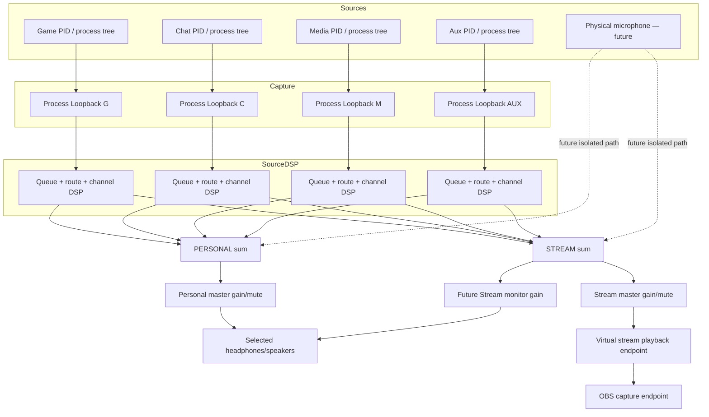

# AudioMixer — system architecture

## Product boundary

The Windows computer owns all real-time audio capture, processing, routing, and mixing. Android is a remote control surface. Windows UI and Android UI are clients of one authoritative Host state; neither UI owns audio state.

## Logical modules

| Module | Responsibility | Proposed implementation |
|---|---|---|
| Windows Host | Process lifetime, settings, profiles, API, tray, recovery | C# / .NET 10 LTS |
| Audio Engine | Capture orchestration, per-source queues, mixing, output | NAudio WASAPI to begin; native C++ only if profiling proves necessary |
| Audio Devices | Endpoint enumeration, selection, notifications, virtual endpoints | Core Audio / WASAPI; third-party virtual endpoints initially |
| Application Manager | Sessions, PID/process metadata, route rules | `IAudioSessionManager2` via NAudio; Win32 process metadata |
| DSP Engine | EQ/effects graph, meters, peak protection | C# float DSP in first iterations; evaluate native SIMD later |
| Communication Layer | WebSocket, USB transport abstraction, auth, state replication | ASP.NET Core WebSocket / `ClientWebSocket`; transport adapters |
| Windows UI | Full desktop mixer | WPF or WinUI 3; choose after audio MVP |
| Android UI | Mobile touch-first mixer/remote | Kotlin + Jetpack Compose |
| Settings & Profiles | Auto-save, schema migration, profile matching | `System.Text.Json`, atomic write; SQLite only if history grows |

## Audio graph and two-mix model



The engine uses one canonical internal format in the prototype: 48,000 Hz, stereo, 32-bit IEEE float. Each PID owns a bounded ring buffer. A 10 ms scheduler reads a fixed block from each source, pads under-runs with silence, applies independent PERSONAL/STREAM channel gain and mute, sums sources, applies safety soft clipping, then writes each mix to a separate WASAPI shared-mode player.

## State model

Each channel owns:

```text
ChannelState {
  id, name, color
  personal: { gain, muted }
  stream:   { gain, muted }
  sourceIds[]
  dspChain[]
}
```

Each source owns process identity, process-tree capture handle, selected channel, activity/peak metadata, and capture error status. A process route is persisted by stable executable name (optionally upgraded later to package identity / executable path and user-defined match rules), not by ephemeral PID.

Each mix owns master gain/mute and output endpoint. Stream monitor is a separate monitor-only path: it must never be multiplied into the STREAM send itself.

## Source routing and the no-double-audio rule

For the first prototype, the user assigns apps to a virtual playback endpoint using Windows Volume Mixer. The prototype discovers sessions on this endpoint and separately taps the PID with Process Loopback. The endpoint is an ingress *selector* and a way to avoid leaving the source directly audible on the physical endpoint. It is not the actual audio tap.

Later, transparent routing without manual per-app endpoint selection requires either a supported existing virtual audio driver and reliable route control, or a project-owned signed virtual audio driver. User-mode Core Audio session APIs alone do not create arbitrary per-process virtual endpoints.

## UI ↔ Host synchronization

Host state is authoritative. UI clients send versioned commands (`SetChannelGain`, `SetMute`, `MoveSource`, `SelectDevice`, `LoadProfile`) with a client command ID and expected state revision. Host validates, applies the state change, atomically persists durable settings, and broadcasts a compact state delta to all clients. Audio-thread parameters should be published as immutable snapshots or atomics; no UI or network callback may block the real-time audio path.

## Failure containment

- Audio capture/output threads are not UI threads.
- All per-process queues are bounded; old samples are dropped on overflow rather than allowing unbounded latency.
- Output buffers are bounded and expose drop/under-run metrics.
- Device invalidation must stop and recreate only the affected endpoint path, not the full host.
- A saved routing choice must never silently redirect the system default endpoint.
- Startup and driver setup must be recoverable: if a virtual endpoint is missing, the host remains open in an explicit degraded state and keeps original Windows audio routing intact.
